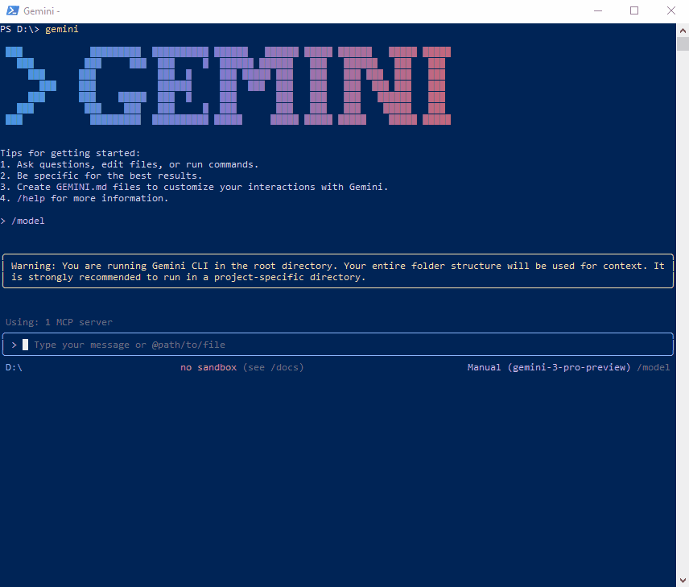
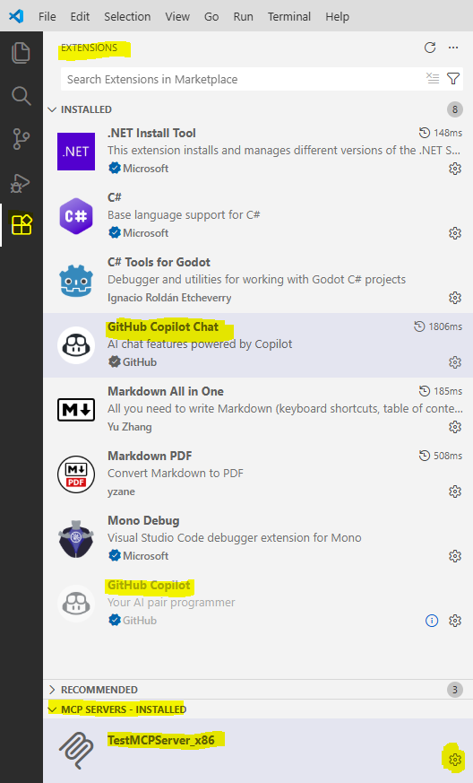
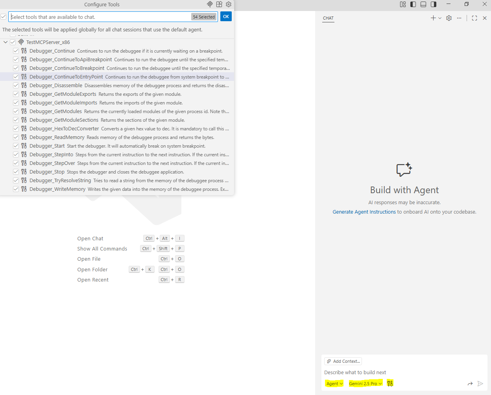

# Fatmike's MCP Debugger Server

## Introduction

This project is a self-made, lightweight **MCP Debugger Server** developed for learning and experimentation. The **MCP Debugger Server** exposes debugger functionality as MCP tools, enabling external MCP clients to control execution, inspect memory, and analyze the debuggee through a clean interface.  

The debugger is written in c++ and implements core debugging functionality from scratch without relying on existing debugger frameworks. For instruction decoding the [Zydis](https://github.com/zyantific/zydis) disassembler is used. The debugger is integrated with an MCP server written in c#, built using the [official MCP C# SDK](https://github.com/modelcontextprotocol/csharp-sdk). 

**Keywords**:  
MCP server, debugger, disassembler, static analysis, dynamic analysis, debugging, AI, EXE, executable, Windows

## Demo



> *Gemini CLI* was used as MCP Client in the Demo

## Quickstart: Setting up MCP.Server.exe in VS Code

This guide provides a step-by-step process for building and integrating the **MCP.Server.exe** into Visual Studio Code on **Windows**.

### Step 1: Build the Solution
Before configuring VS Code, you must compile the mcp server:
1. Open `MCPDebugger.slnx` in Visual Studio 2026. Required workloads: **Desktop development with C++** including the components **C++/CLI support for v145 build tools** and **vcpkg package manager**, and **.NET desktop development** (it installs the .NET 10 SDK the solution targets). Older Visual Studio versions do not have the v145 toolset and cannot build the solution.
2. Build the solution
3. Confirm that `MCP.Server.exe` exists in your `\build\Release\x86` or `\build\Release\x64` subfolder.

> The first build of a configuration and platform needs access to GitHub: the native test project gets Google Test through vcpkg, and vcpkg reads its package registry from there whenever it installs into a fresh `build` folder. Later builds of the same configuration and platform work offline. vcpkg sends usage data to Microsoft unless the environment variable `VCPKG_DISABLE_METRICS` is set.

> `MCP.Server.exe` needs the .NET 10 runtime in its own architecture: the x86 server needs the x86 runtime, the x64 server the x64 runtime.

### Step 2: Install Required VS Code Extensions
Ensure the following extensions are installed and active in VS Code:
* **GitHub Copilot**
* **GitHub Copilot Chat**

### Step 3: Add the MCP Server
1. Press **`Ctrl` + `Shift` + `P`** to open the Command Palette.
2. Type **`>`** and select **"Add MCP Server"**.
3. Choose **`command` (stdio)** as the server type.

### Step 4: Configure the Path
Enter the full path to `MCP.Server.exe` you built in Step 1.
> [!CAUTION]
> Only **one** architecture (x86 or x64) should be active as MCP server at a time. If you switch architecture, remove the previous server entry first.

| Architecture | Example Path to Enter |
| :--- | :--- |
| **Windows x64** | `C:\YourProject\bin\x64\MCP.Server.exe` |
| **Windows x86** | `C:\YourProject\bin\x86\MCP.Server.exe` |

### Step 5: Finalize & Use
1. **Name the Server:** Enter a name for the MCP Server and press **Enter**.
2. **Verify:** Open **Copilot Chat** (**`Ctrl` + `Alt` + `I`**), switch to **Agent Mode**, and click the **Tools** icon. Your MCP tools should now be listed and ready for use. MCP tools can be enabled / disabled here.

### VS Code Screenshots

#### VS Code: Toolbar with installed extensions and MCP Server



#### VS Code: Copilot Chat Window


## Model Recommendations

For complex debugging and reverse-engineering tasks using this MCP debugger, **Claude Opus 4.5** delivered by far the best results as of **November 2025**. It consistently handled large execution traces, detailed disassembly, and multi-step reasoning more reliably than other tested models.

**ChatGPT 4.1** and **Gemini 2.5 Pro** were sufficient for simpler analysis scenarios, such as basic stepping, instruction inspection, and straightforward control-flow reasoning. These models performed well for the examples provided in the `Example_x64` and `Example_x86` folders, but showed limitations when dealing with more complex or long-running debugging sessions.

Model performance may change over time, but the above reflects observed behavior at the time of testing.

## Disclaimer

Debugging via MCP can result in **high token usage and increased costs**. AI interactions are stateless, which means that all relevant debugging context (registers, memory, disassembly, modules, etc.) must be transferred repeatedly with each request.

Operations that frequently stop execution and return detailed state—such as stepping and temporary breakpoints—can significantly amplify token consumption.

If **low-cost operation is required**, it is strongly recommended to focus on static analysis and disable the following MCP tools:

- **Debugger_ContinueToBreakpoint**
- **Debugger_ContinueToApiBreakpoint**
- **Debugger_StepInto**
- **Debugger_StepOver**

Disabling these tools reduces the amount of repeated state transfer and helps keep token usage under control.

## Examples

The repository includes example projects to help get started with static analysis and debugging and are located in the following folders:

- **Example_x64** and **Example_x86**  
  The `Example_x64` and `Example_x86` projects provide a simple console application used as an introductory debugging target. The application prompts the user to enter a password at runtime. The correct password for both examples is *secret*.

- **MCP_Debugging_Sessions**  
  A folder containing more complex debugging sessions that leverage dynamic analysis and debugging. In these sessions **Claude Opus 4.5** was used. The targets can be downloaded [here.](https://crackmes.one/user/Fatmike) Please note that the targets were unpacked using `UPX -d` before using the MCP Debugger.

## MCP Tools

The MCP server exposes the following tools to interact with the debugger:

### Debugger Lifecycle
- **Debugger_Start**  
  Starts the debugger for the specified executable and breaks on the initial system breakpoint.

- **Debugger_Stop**  
  Stops the debugger and terminates the debuggee process.

### Execution Control
- **Debugger_Continue**  
  Continues execution when the debuggee is stopped at a breakpoint.

- **Debugger_ContinueToEntryPoint**  
  Continues execution from the system breakpoint to the program entry point.

- **Debugger_ContinueToBreakpoint**  
  Continues execution until a temporary breakpoint at a specified virtual address is reached.

- **Debugger_ContinueToApiBreakpoint**  
  Continues execution until a temporary breakpoint on a specified API function is reached.

- **Debugger_StepInto**  
  Steps into the next instruction, entering function calls.

- **Debugger_StepOver**  
  Steps over function calls and continues to the next instruction.

### Code & Memory Inspection
- **Debugger_Disassemble**  
  Disassembles memory at a given virtual address and returns instructions including symbol information.

- **Debugger_TryResolveString**  
  Attempts to resolve and read a string from the debuggee’s memory.

- **Debugger_ReadMemory**  
  Reads raw memory bytes from the debuggee process.

- **Debugger_WriteMemory**  
  Writes arbitrary bytes into the debuggee’s memory.

### Module Inspection
- **Debugger_GetModules**  
  Returns a list of currently loaded modules for the debuggee process.

- **Debugger_GetModuleImports**  
  Returns the imported functions of a specified module.

- **Debugger_GetModuleExports**  
  Returns the exported functions of a specified module.

- **Debugger_GetModuleSections**  
  Returns section information of a specified module.

### Utilities
- **Debugger_HexToDecConverter**  
  Converts hexadecimal values to decimal to avoid number conversion errors.

## Solution Overview

The Visual Studio solution is organized into the following projects:

- **MCP.Debugger**  
  The core debugger implemented in C++. It includes a C++/CLI bridge to expose a managed interface for .NET clients.

- **MCP.Debugger.Tester**  
  A simple WinForms application used to test the debugger through the managed .NET interface.

- **MCP.Debugger.Types**  
  A types assembly that defines shared structures and data types for managed-native transitions between the debugger and .NET clients.

- **MCP.Server**  
  The C# MCP server that exposes debugger functionality as MCP tools for external clients.

Test projects (solution folder `Tests`; NUnit, except for the native tests):

- **MCP.Debugger.IntegrationTests**  
  Integration tests of the debugger through its managed .NET interface, run against the sample targets in `Examples`.

- **MCP.Debugger.NativeTests**  
  Native unit tests of the C++ classes of `MCP.Debugger`, written with Google Test and gMock. The test binary compiles the sources of the classes it tests a second time, as plain native code, because the C++/CLI project offers no library a native binary could link.

- **MCP.Server.IntegrationTests**  
  Integration tests of the MCP server: they start the built `MCP.Server.exe` and call its tools as an MCP client over stdio.

- **MCP.Server.Tests**  
  Unit tests of the MCP server's classes. They start no process: the debugger is replaced by Moq mocks. The project also checks two structure rules of the server (interfaces live under `MCP.Server.Interfaces`; a class receives its collaborators as interfaces).

- **MCP.Debugger.Tests**  
  Unit tests of the managed classes of `MCP.Debugger` that need no native debugger, currently the console dispatcher. The debugger service itself is covered by `MCP.Debugger.IntegrationTests`: a C# test cannot replace the native debugger behind it.

- **MCP.Debugger.Types.Tests**  
  Unit-test project of `MCP.Debugger.Types`. It is set up but does not contain tests yet.

### Packages

The executables wire their objects with a dependency-injection container: the server, the tester and the debugger integration tests create the debugger through it, and `MCP.Debugger` offers the registration for it. Every project references the same version.

| Package | Version | License | Used by |
| :--- | :--- | :--- | :--- |
| `Microsoft.Extensions.DependencyInjection` | 10.0.15 | MIT | `MCP.Server`, `MCP.Debugger.Tester`, `MCP.Debugger.IntegrationTests`: the container |
| `Microsoft.Extensions.DependencyInjection.Abstractions` | 10.0.15 | MIT | `MCP.Debugger`: the registration of the debugger service (`AddDebuggerService`); it is also the only dependency of the container package |

## Running the tests

The solution has two kinds of tests: the NUnit tests of the C# test projects and the native Google Test tests of `MCP.Debugger.NativeTests`.

The integration tests debug the sample targets `Examples\Example_x64\Example.exe` and `Examples\Example_x86\Example.exe` up to their entry point and a few instructions beyond it. They need no user interaction; a console window of the sample target may show up briefly. The native tests are unit tests: they start no process.

1. Build the solution for the configuration and platform you want to test (see [Step 1: Build the Solution](#step-1-build-the-solution)). The tests always run against that build: the x64 tests debug the x64 sample target with the x64 debugger and server, the x86 tests the x86 ones. The .NET 10 runtime of the same architecture must be installed.
2. Run the tests of that build, in Visual Studio or from the command line.

### In Visual Studio

Open the **Test Explorer** and run all tests. It lists and runs the NUnit tests and the native tests for the solution platform (x64 or x86) that is currently selected. The native tests need the Visual Studio component **Test Adapter for Google Test** (workload *Desktop development with C++*).

### From the command line

`RunTests.cmd` runs all tests of one build: first the NUnit test assemblies, then the native test binary. Call it from the repository root, in a command prompt or in PowerShell:

```
.\RunTests.cmd <Debug|Release> <x64|x86>
```

| Build | Command |
| :--- | :--- |
| **Debug x64** | `.\RunTests.cmd Debug x64` |
| **Debug x86** | `.\RunTests.cmd Debug x86` |
| **Release x64** | `.\RunTests.cmd Release x64` |
| **Release x86** | `.\RunTests.cmd Release x86` |

A run takes 15 to 20 seconds; the native tests account for a few milliseconds of it.

| Exit code | Meaning |
| :--- | :--- |
| **0** | All tests of both frameworks passed. |
| **1** | At least one NUnit test or native test failed. |
| **2** | Wrong arguments, or there is no build of that configuration and platform. |

- The script builds nothing. It runs what the last build of that configuration and platform produced, so build first.
- Both parts always run: a failing NUnit test does not keep the native tests from running, and the other way round.
- The NUnit part is `dotnet test "build/<Configuration>/<Platform>/MCP.*Tests/MCP.*Tests.dll"`. It takes the built test assemblies, not the solution: `dotnet test MCPDebugger.slnx` does not work, because the `dotnet` command line cannot load the C++/CLI project of the solution. `dotnet test` cannot run the native test binary either; the script starts it directly.
- The unit-test projects without tests are reported with the note that no test is available; they do not make the run fail.
- Exit code 1 is also returned when the check at the end of the NUnit run found an `Example.exe` or `MCP.Server.exe` process the tests left behind. In that case all tests are listed as passed and the output contains `TearDown failed for test fixture ... RunFixture`.
- Do not run the two integration-test assemblies in parallel: both debug the same sample target, and the check at the end of a run would report the processes of the other assembly.

### Test packages

All NUnit test projects use the same package versions; they are defined once in `Tests.props`.

| Package | Version | License | Purpose |
| :--- | :--- | :--- | :--- |
| `NUnit` | 5.0.0 | MIT | Test framework |
| `NUnit3TestAdapter` | 6.3.1 | MIT | Lets `dotnet test` and the Visual Studio Test Explorer find and run NUnit tests |
| `Microsoft.NET.Test.Sdk` | 18.12.0 | MIT | Test host and build integration of the test projects |
| `NUnit.Analyzers` | 4.15.0 | MIT | Compile-time checks of the test code |
| `Moq` | 4.21.0 | BSD-3-Clause | Mocks of the interfaces a tested class depends on |
| `ModelContextProtocol.Core` | 2.4.0 | Apache-2.0 | MCP client of the server integration tests (same version as the SDK used by `MCP.Server`); only in `MCP.Server.IntegrationTests` |
| `Microsoft.Extensions.DependencyInjection` | 10.0.15 | MIT | Container the debugger integration tests take the debugger service from (same version as in `MCP.Server`, see [Packages](#packages)); only in `MCP.Debugger.IntegrationTests` |

The packages these pull in are licensed under MIT (Microsoft test platform and `Microsoft.Extensions.*` packages; `System.Diagnostics.EventLog` 6.0.0, through `Castle.Core`) or Apache-2.0 (`Castle.Core` 5.2.1, the proxy generator of `Moq`).

The native tests use Google Test, which is not a NuGet package: vcpkg builds it from source during the build and links it statically into the test binary. The version is pinned in `MCP.Debugger.NativeTests/vcpkg.json` (registry baseline plus version override).

| Package | Version | License | Purpose |
| :--- | :--- | :--- | :--- |
| `gtest` (vcpkg port: Google Test and gMock) | 1.17.0 | BSD-3-Clause | Test and mocking framework of the native tests; only in `MCP.Debugger.NativeTests` |

The vcpkg helper ports used to build it (`vcpkg-cmake`, `vcpkg-cmake-config`) are licensed under MIT.
